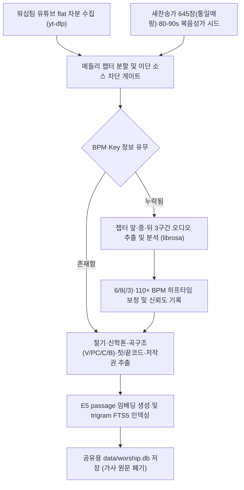
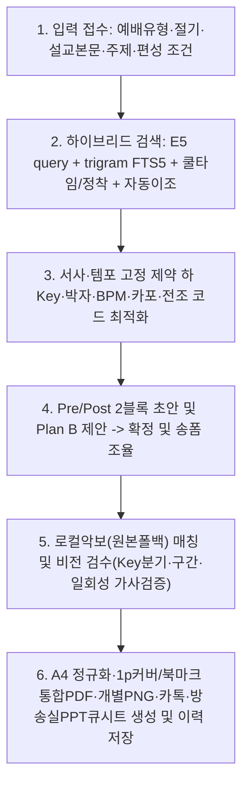

# 한국 찬양 콘티 에이전트 Skill 설계서 (`korean-worship-setlist`)

본 문서는 `/grill-me` 인터뷰와 다중 페르소나(`/swarm`: 목사·찬양인도자·악기 세션·기술 아키텍트) 최종 검토를 거쳐 확정된 **P0·P1 수정 사항까지 모두 반영한** 한국 교회 찬양 콘티 기획 및 악보 송폼 스탬핑 에이전트 Skill 설계서입니다.

---

## 1. 프로젝트 개요 및 핵심 목표

### 1.1 목적
한국 교회의 다양한 예배 상황(주일 대예배, 청년부 예배, 금요기도회/수련회, 소그룹 등)과 교회력 절기에 맞춰 **설교·주제 기반 선곡**부터 **음악적 흐름 설계(Key·이조·BPM·박자·음역대)**, **악보 탐색 및 멀티모달 비전 검수**, **상단 송폼(`I(4m) - V1 - PC - C(x2) - Inter - B - C - O`) 배너 합성 및 통합 PDF·방송실 큐시트 생성**까지 일관된 워크플로우로 자동화하는 에이전트 Skill(`korean-worship-setlist`)을 구축합니다.

### 1.2 핵심 설계 원칙
1. **100% 로컬 구동 & Zero API Key (경량 런타임 vs 빌더 분리)**
   - 별도의 유료 외부 API 키(OpenAI/Gemini/YouTube Data API 등) 발급이나 API 호출 비용 없이 로컬 Python 환경만으로 동작합니다.
   - **Windows 실행 표준**: `pyproject.toml` 기반으로 **`uv run`(Python 3.11 / 3.12 권장)** 실행을 표준화합니다.
   - **의존성 분리**:
     - `runtime` (일반 사용자/교회 사역자용): `numpy`, `Pillow`, `pypdf`, `pypdfium2`(Poppler 불필요 PDF 래스터라이저), `reportlab`, `onnxruntime` / `sentence-transformers` (모델 오프라인 프리페치 지원, 미캐시·오프라인 환경 시 SQLite FTS5 전용 모드로 자동 폴백)
     - `builder` (DB 수집·오디오 분석용): `yt-dlp`, `librosa`, `imageio-ffmpeg`
2. **저작권 안전 아키텍처 (무가사 시맨틱 DB + 물리적 DB 2원화)**
   - 추후 Git/스킬 마켓플레이스 공유·배포 시 저작권 침해와 이력 덮어쓰기를 원천 차단하기 위해 **배포용 공유 DB(`data/worship.db`)** 와 **로컬 전용 교회 이력 DB(`data/church_local.db`, `.gitignore`)** 를 물리적으로 분리합니다.
   - `worship.db`에는 **가사 전문이나 악보 이미지를 저장하지 않으며**, 사실적 메타데이터(곡명, 팀, 연도, Key, BPM, 박자, 곡 섹션 구조, 저작권 메타)와 **신학적 핵심·주의 뉘앙스·키워드 태그·표준 성경 코드·예배 단계·시맨틱 임베딩 벡터·최소 식별 첫 구절(`first_line_incipit`, 15자 이내)** 만 저장합니다.
   - 악보는 사용자의 로컬 악보 폴더를 1순위로 매칭하며, 웹 탐색 시 비공식 이미지의 자동 PDF 병합을 금지합니다.
3. **전 세대·전 장르 커버리지 및 신학적 건전성 게이트**
   - 2000~2020년대 모던 워십팀(마커스워십, 어노인팅, 제이어스, 위러브, 아이자야씩스티원, 예수전도단 등)뿐 아니라 **80~90년대 고전 복음성가**와 **새찬송가(645장·통일찬송가 매핑)** 를 단일 DB로 지원합니다.
   - 한국 주요 교단 이단·논란 단체/작곡가 차단 목록(`data/blocked_sources.json`)을 수집·검색·검수 전 단계의 게이트로 적용합니다.

---

## 2. 디렉터리 및 Skill 패키지 구조

워크스페이스 루트 내에 Antigravity 표준 Skill 디렉터리 규격(`.agents/skills/`)으로 구성합니다.

```text
.agents/skills/korean-worship-setlist/
├── pyproject.toml                  # runtime / builder 의존성 분리 및 uv 실행 명세 (Python 3.11/3.12)
├── SKILL.md                        # 에이전트용 메인 런북 (Progressive Disclosure 적용)
├── scripts/
│   ├── common.py                   # DB 연결(ATTACH), 조성/음역 수학, 성경 코드 정규화, 이단 게이트
│   ├── init_db.py                  # worship.db(공유) & church_local.db(로컬) 초기화 및 FTS5 trigram 구성
│   ├── build_bulk_catalog.py       # 4대 공개 소스 통합(3,500+곡) 카탈로그 구축
│   ├── init_profile.py             # `/korean-worship-setlist init` 사역팀·세션·음역·로컬 악보 경로 인터뷰 초기화
│   ├── collect_youtube.py          # 워십팀 유튜브 flat 차분 수집·메들리 챕터 분할·이단 소스 차단 (yt-dlp)
│   ├── analyze_audio.py            # 앞·중·뒤 3구간 BPM·Key 분석 및 4/4·6/8 배수 착시 보정 (librosa)
│   ├── enrich_metadata.py          # 절기·신학톤·곡구조·저작권 메타 + E5("passage: ") 로컬 임베딩 생성
│   ├── search_candidates.py        # 하이브리드 검색(E5 "query: " + trigram FTS5/LIKE + 자동 이조 + 쿨타임/정착)
│   ├── plan_transitions.py         # 서사·템포 고정 제약 위 Key·박자·BPM·카포·전조 브릿지 코드 최적화
│   ├── find_sheets.py              # 로컬 악보 폴더 퍼지 매칭(원본 Key 폴백 포함), 비전 검수·재계산 및 공식 웹 링크
│   ├── fetch_sheets.py             # 사용자 요청 시 공개 악보 URL 안전 수집(SSRF·차단·해상도 게이트)
│   ├── stamp_sheets.py             # pypdfium2/Pillow 기반 A4 정규화·1p/2p+ 배너·1p 총괄 커버·PDF 북마크·4종 출력
│   └── manage_history.py           # `bootstrap` 초기 시딩, 교회 레퍼토리·고정곡·신곡 정착·이력 관리
├── references/
│   ├── init.md                     # `/korean-worship-setlist init` 4단계 온보딩 인터뷰 명세
│   ├── worship_presets.md          # 예배 유형·교회력 절기·말씀 전/후 2블록(Reprise)·소편성 프리셋 가이드
│   ├── key_transition_guide.md     # 전조 공식(V7, V7sus4=IV/V, IVm6, 첫코드 연동, 박자/BPM 갭 전환, 카포 매핑)
│   └── song_form_conventions.md    # 송폼 규격(I(4m), [C only], x2, Vamp, Medley) 및 비전 검수(가사·Key·구간) 절차
├── resources/
│   └── fonts/                      # OFL 한글 고딕 폰트 내장 (OS 폰트 미설치 환경 대비)
└── data/
    ├── worship.db                  # 배포 가능한 공유 DB (무가사 메타 + 섹션 구조 + 임베딩, song_slug 기준)
    ├── blocked_sources.json        # 이단·논란 단체/작곡가 차단 게이트 목록
    ├── user_config.example.json    # 사역팀 프로필·세션 난이도·로컬 악보 경로 설정 예시
    ├── church_local.db             # (.gitignore) 로컬 전용 DB (repertoire, setlist_history, sheet_cache)
    └── user_config.json            # (.gitignore) 사용자 실제 사역팀 설정 파일
```

### 주요 컴포넌트 역할 요약

| 구분 | 파일/디렉터리 | 핵심 역할 |
| :--- | :--- | :--- |
| **패키징/런북** | `pyproject.toml`, `SKILL.md` | `uv run` 기반 경량 런타임/빌더 분리 및 6단계 콘티·스탬핑 실행 절차 정의 |
| **수집/분석** | `collect_youtube.py`, `analyze_audio.py`, `enrich_metadata.py` | 챕터 단위 증분 수집, 3구간 오디오 BPM/6·8박자 보정, 신학/절기/섹션 메타 및 E5 임베딩 구축 |
| **선곡/조성** | `search_candidates.py`, `plan_transitions.py`, `manage_history.py` | 자동 이조·절기 필터·콜드스타트/정착 관리, 서사 고정 하 Key·박자·카포·전조 코드 설계 |
| **악보/스탬프** | `find_sheets.py`, `stamp_sheets.py` | 로컬 악보(원본 폴백 포함) 매칭, 비전 검수 후 1p 커버·북마크 통합 PDF 및 방송실 큐시트 등 4종 생성 |
| **자산/가이드** | `resources/fonts/`, `references/*.md`, `blocked_sources.json` | 내장 한글 폰트, 이단 차단 게이트, 예배/전조/송폼 표준 가이드(온디맨드 로드) |

---

## 3. 데이터베이스 스키마 설계 (`SQLite` 물리 2원화)

배포용 **`data/worship.db`** 업데이트 시 개인/교회 데이터가 덮어쓰이거나 유출되지 않도록, 두 DB를 물리적으로 분리하고 안정적인 논리 키 **`song_slug`** 로 연결합니다. 런타임 스크립트는 `worship.db` 연결 후 `ATTACH DATABASE 'church_local.db' AS local_db`를 수행해 단일 쿼리로 조인합니다.

### 3.1 `worship.db` 테이블 구조 상세 (공유·배포용)

1. **`songs` 테이블 (원곡·신학·절기·저작권·무가사 메타데이터)**
   - 식별/검색: `id`, `song_slug` (`UNIQUE`, 예: `juga-ilhasi-ne-markers`), `title_ko`, `title_en`, `normalized_title`, `alternate_titles` (JSON 배열), `first_line_incipit` (동명이곡/자막 식별용 첫 4~5어절, **최대 15자 제한**)
   - 분류/세대/접근성: `category` (`modern_worship` | `classic_gospel` | `hymn`), `hymn_number` (새찬송가), `hymn_number_unified` (통일찬송가), `era` (`1980s`~`2020s` | `traditional`), `original_artist`, `release_year`, `adoption_tier` (`core_standard` | `widely_sung` | `recent_rising` | `niche`), `lyric_accessibility` (`easy_seeker` | `standard_church` | `deep_theological`)
   - 예배·신학·절기 정보:
     - `church_seasons` (JSON 배열: `ordinary`, `advent`, `christmas`, `epiphany`, `lent`, `holy_week`, `easter`, `pentecost`, `thanksgiving`, `watchnight`, `communion`, `baptism`)
     - `service_slots` (JSON 배열: `pre_service`, `introit_doxology`, `worship_set`, `offertory`, `sermon_response`, `sending_benediction`)
     - `liturgical_stages` (JSON 배열: `opener`, `declaration`, `meditation`, `confession`, `dedication`, `sending`)
     - `theological_tone` (`adoration`, `penitence`, `cross_sacrifice`, `resurrection_victory`, `comfort_trust`, `mission_sending`, `blessing_fellowship`)
     - `lyrical_perspective` (`god_centered_vertical`, `gospel_proclamation`, `communal_exhortation`, `personal_testimony`)
     - `theological_core` (핵심 교리·구속사 요지), `caution_nuance` (설교 매칭 시 주의할 뉘앙스), `theme_summary` (1줄 요약), `theme_tags` (JSON), `scripture_refs` (JSON 표준 코드, 예: `["PSA.23", "ISA.43"]`)
   - 곡 구조 정보: `available_sections` (JSON 배열: `["I", "V1", "V2", "PC", "C", "B", "Tag", "O"]`), `default_song_form`
   - 저작권·건전성 게이트: `lyricist`, `composer`, `copyright_holder`, `ccli_number`, `copyright_scope` (`ccli_covered` | `komca_separate` | `khs_hymn` | `public_domain`), `source_status` (`verified_official` | `community_reviewed` | `caution_disputed` | `blocked_heresy`), `theological_notes`

2. **`arrangements` 테이블 (찬양팀별 편곡 및 합주 메타데이터, 1:N)**
   - 기본 정보: `id`, `song_id` (FK), `worship_team`, `recorded_year`, `youtube_url`, `youtube_start_sec` (챕터 딥링크 시작 초)
   - 조성/박자/템포: `key_signature` (조표 기준 메이저 정규화 + 단조 병기, 예: `G`, `Em (G Key)`), `time_signature` (`4/4`, `6/8`, `3/4`, `12/8`), `bpm` (정수), `tempo_tier` (`ballad` | `medium` | `fast`), `groove_style`
   - 화성·합주 디테일: `intro_first_chord`, `outro_last_chord`, `ending_type` (`pad_hold` | `clean_cut` | `ritardando` | `vamp`), `drum_grooves` (JSON 배열: `4_on_floor`, `16th`, `6_8_worship`, `rimshot`, `tom_build`, `break`), `section_dynamics` (JSON), `arrangement_song_form` (마디·반복 포함 표기)
   - 음역·편성·신뢰도: `lowest_note`, `highest_note` (결측 허용, 비전/수동 큐레이션 보완), `vocal_range_fit`, `congregation_singability` (`hymn_traditional` | `modern_simple` | `syncopated_band`), `band_dependency` (`low` | `medium` | `high`), `session_fit` (JSON), `key_source` (`youtube_parsed` | `manual_seed` | `audio_estimated`), `bpm_source` (`manual_seed` | `librosa_verified` | `librosa_estimated`), `confidence` (`0.0~1.0`), `is_default`

3. **`song_embeddings` & `songs_fts` 테이블 (한글 특화 검색 인덱스)**
   - `song_embeddings`: `song_id` (PK/FK), `model_name` (`intfloat/multilingual-e5-small`), `dimension` (`384`), `embedding` (float32 BLOB)
   - `songs_fts`: **SQLite FTS5 `tokenize='trigram'`** 적용 가상 테이블. 한국어 조사 결합(`"예배합니다"`)이나 띄어쓰기 제거 제목(`"주가일하시네"`)에서 부분 문자열 매칭을 보장하며, 1~2음절 핵심 단어(`"빛"`, `"은혜"`, `"길"`) 검색을 위해 `LIKE` 폴백을 병행하고 `songs`/`arrangements` 갱신 시 동기화 헬퍼가 자동 갱신합니다.

### 3.2 `church_local.db` 테이블 구조 상세 (로컬 전용, `.gitignore`)

1. **`repertoire` 테이블**: `song_slug` (`PRIMARY KEY`), `familiarity` (`'pinned_ritual'` 고정 송영/축복송 | `'favorite'` 애창곡 | `'familiar'` 익숙함 | `'learning'` 신곡 정착 중 | `'new'` 미경험 | `'unknown'` 미분류[기본값] | `'excluded'` 제외), `preferred_key`, `times_sung`, `consecutive_learning_count`, `last_sung_date`, `team_memo`
2. **`setlist_history` 테이블**: `id`, `service_date`, `service_type`, `cooldown_scope` (예: `주일대예배`, `청년부`, `금요기도회`), `service_part` (`1부`/`2부`/`3부` 중복 카운트 방지), `preacher`, `sermon_title`, `sermon_scripture`, `church_season`, `theme_input`, `setlist_json`, `output_dir`, `created_at`
3. **`sheet_cache` 테이블**: `id`, `song_slug`, `file_path`, `detected_key`, `page_count`, `verified_sections_json`, `verified_at`

### 3.3 SQLite DDL 초안

```sql
-- ==========================================
-- [1] data/worship.db (공유·배포용 DB)
-- ==========================================
CREATE TABLE IF NOT EXISTS songs (
    id INTEGER PRIMARY KEY AUTOINCREMENT,
    song_slug TEXT NOT NULL UNIQUE,
    title_ko TEXT NOT NULL,
    title_en TEXT,
    normalized_title TEXT NOT NULL,
    alternate_titles TEXT NOT NULL DEFAULT '[]',     -- JSON array
    first_line_incipit TEXT,                         -- <= 15자 식별용 첫 구절
    category TEXT NOT NULL CHECK (category IN ('modern_worship', 'classic_gospel', 'hymn')),
    hymn_number INTEGER,
    hymn_number_unified INTEGER,
    era TEXT NOT NULL CHECK (era IN ('1980s', '1990s', '2000s', '2010s', '2020s', 'traditional')),
    original_artist TEXT,
    release_year INTEGER,
    adoption_tier TEXT NOT NULL DEFAULT 'widely_sung'
        CHECK (adoption_tier IN ('core_standard', 'widely_sung', 'recent_rising', 'niche')),
    lyric_accessibility TEXT NOT NULL DEFAULT 'standard_church'
        CHECK (lyric_accessibility IN ('easy_seeker', 'standard_church', 'deep_theological')),
    church_seasons TEXT NOT NULL DEFAULT '["ordinary"]', -- JSON array
    service_slots TEXT NOT NULL DEFAULT '["worship_set"]',-- JSON array
    liturgical_stages TEXT NOT NULL DEFAULT '[]',    -- JSON array
    theological_tone TEXT NOT NULL DEFAULT 'adoration',
    lyrical_perspective TEXT NOT NULL DEFAULT 'god_centered_vertical',
    theological_core TEXT NOT NULL DEFAULT '',
    caution_nuance TEXT DEFAULT '',
    theme_summary TEXT NOT NULL,
    theme_tags TEXT NOT NULL DEFAULT '[]',           -- JSON array
    scripture_refs TEXT NOT NULL DEFAULT '[]',       -- JSON array (표준 코드 예: "ROM.8")
    available_sections TEXT NOT NULL DEFAULT '[]',   -- JSON array e.g. ["I","V1","PC","C","B","O"]
    default_song_form TEXT,
    lyricist TEXT,
    composer TEXT,
    copyright_holder TEXT,
    ccli_number TEXT,
    copyright_scope TEXT DEFAULT 'komca_separate'
        CHECK (copyright_scope IN ('ccli_covered', 'komca_separate', 'khs_hymn', 'public_domain')),
    source_status TEXT NOT NULL DEFAULT 'community_reviewed'
        CHECK (source_status IN ('verified_official', 'community_reviewed', 'caution_disputed', 'blocked_heresy')),
    theological_notes TEXT,
    created_at TEXT DEFAULT (datetime('now')),
    updated_at TEXT DEFAULT (datetime('now'))
);

CREATE TABLE IF NOT EXISTS arrangements (
    id INTEGER PRIMARY KEY AUTOINCREMENT,
    song_id INTEGER NOT NULL REFERENCES songs(id) ON DELETE CASCADE,
    worship_team TEXT NOT NULL,
    key_signature TEXT NOT NULL,
    time_signature TEXT NOT NULL DEFAULT '4/4',
    bpm INTEGER NOT NULL,
    tempo_tier TEXT NOT NULL CHECK (tempo_tier IN ('ballad', 'medium', 'fast')),
    groove_style TEXT,
    intro_first_chord TEXT,
    outro_last_chord TEXT,
    ending_type TEXT DEFAULT 'pad_hold'
        CHECK (ending_type IN ('pad_hold', 'clean_cut', 'ritardando', 'vamp')),
    drum_grooves TEXT NOT NULL DEFAULT '[]',         -- JSON array
    section_dynamics TEXT NOT NULL DEFAULT '{}',     -- JSON object
    lowest_note TEXT,
    highest_note TEXT,
    vocal_range_fit TEXT DEFAULT 'congregation_comfortable',
    congregation_singability TEXT DEFAULT 'modern_simple'
        CHECK (congregation_singability IN ('hymn_traditional', 'modern_simple', 'syncopated_band')),
    band_dependency TEXT NOT NULL DEFAULT 'medium'
        CHECK (band_dependency IN ('low', 'medium', 'high')),
    session_fit TEXT NOT NULL DEFAULT '["full_band"]', -- JSON array
    arrangement_song_form TEXT,
    youtube_url TEXT,
    youtube_start_sec INTEGER DEFAULT 0,
    recorded_year INTEGER,
    key_source TEXT DEFAULT 'manual_seed',
    bpm_source TEXT DEFAULT 'manual_seed',
    confidence REAL DEFAULT 0.9,
    is_default INTEGER NOT NULL DEFAULT 0
);

CREATE TABLE IF NOT EXISTS song_embeddings (
    song_id INTEGER PRIMARY KEY REFERENCES songs(id) ON DELETE CASCADE,
    model_name TEXT NOT NULL DEFAULT 'intfloat/multilingual-e5-small',
    dimension INTEGER NOT NULL DEFAULT 384,
    embedding BLOB NOT NULL
);

-- trigram 토크나이저로 한국어 부분 문자열 및 띄어쓰기 없는 제목 검색 보장
CREATE VIRTUAL TABLE IF NOT EXISTS songs_fts USING fts5(
    song_id UNINDEXED,
    title_ko,
    title_en,
    normalized_title,
    alternate_titles,
    first_line_incipit,
    theme_summary,
    theological_core,
    theme_tags,
    scripture_refs,
    worship_teams,
    tokenize='trigram'
);

-- ==========================================
-- [2] data/church_local.db (로컬 전용, .gitignore)
-- ==========================================
CREATE TABLE IF NOT EXISTS repertoire (
    song_slug TEXT PRIMARY KEY,
    familiarity TEXT NOT NULL DEFAULT 'unknown'
        CHECK (familiarity IN ('pinned_ritual', 'favorite', 'familiar', 'learning', 'new', 'unknown', 'excluded')),
    preferred_key TEXT,
    times_sung INTEGER NOT NULL DEFAULT 0,
    consecutive_learning_count INTEGER NOT NULL DEFAULT 0,
    last_sung_date TEXT,
    team_memo TEXT
);

CREATE TABLE IF NOT EXISTS setlist_history (
    id INTEGER PRIMARY KEY AUTOINCREMENT,
    service_date TEXT NOT NULL,
    service_type TEXT NOT NULL,
    cooldown_scope TEXT NOT NULL,
    service_part TEXT DEFAULT '1부',
    preacher TEXT,
    sermon_title TEXT,
    sermon_scripture TEXT,
    church_season TEXT DEFAULT 'ordinary',
    theme_input TEXT NOT NULL,
    setlist_json TEXT NOT NULL,
    output_dir TEXT,
    created_at TEXT DEFAULT (datetime('now'))
);

CREATE TABLE IF NOT EXISTS sheet_cache (
    id INTEGER PRIMARY KEY AUTOINCREMENT,
    song_slug TEXT NOT NULL,
    file_path TEXT NOT NULL,
    detected_key TEXT NOT NULL,
    page_count INTEGER NOT NULL DEFAULT 1,
    verified_sections_json TEXT DEFAULT '[]',
    verified_at TEXT DEFAULT (datetime('now'))
);
```

### 3.4 `user_config.example.json` 구조

```json
{
  "config_schema": 1,
  "team_name": "청년부 찬양팀",
  "church_scale": "medium",
  "congregation_age_group": "youth_young_adult",
  "leader_gender": "male",
  "vocal_floor": "A2",
  "vocal_ceiling": "F#4",
  "vocal_ensemble": "small_team",
  "default_session": "full_band",
  "session_instruments": ["piano", "synth_pad", "acoustic_guitar", "electric_guitar", "bass", "drums"],
  "session_skill_tier": "intermediate",
  "seeker_emphasis": false,
  "cooldown_weeks": 6,
  "familiar_ratio": 0.75,
  "show_capo": false,
  "lock_past_keys": false,
  "local_sheet_dirs": [
    "sheet"
  ],
  "default_output_dir": "output"
}
```

---

## 4. 데이터 수집 및 BPM·시맨틱 인덱싱 파이프라인

### 4.1 유튜브 워십팀 메타데이터 수집 (`collect_youtube.py`)
- **수집 대상**: 마커스워십, 어노인팅, 제이어스, 위러브(WELOVE), 아이자야씩스티원, 예수전도단 등 공식 워십팀 유튜브 채널.
- **차분 증분 수집 & 스로틀링**: HTTP 429·봇 차단을 피하기 위해 1단계에서 `extract_flat=True`로 `video_id` 목록만 가볍게 비교한 뒤, 신규 영상에 대해서만 지연 간격(스로틀링)을 두고 상세 설명란·핀 고정 댓글·챕터 정보를 수집합니다.
- **메들리 챕터 분할 & 게이트 적용**: 40분 이상 실황 풀영상은 타임스탬프/챕터를 파싱해 곡별 **`[start_sec, end_sec]` 구간과 `?t=초` 딥링크 URL**을 분리 저장합니다. Key 표기 변형(`G Key`, `G키`, `사장조`)을 정규화하고, `blocked_sources.json`에 해당하는 단체/작곡가는 `source_status='blocked_heresy'`로 즉시 격리합니다.

### 4.2 새찬송가 645장 & 80~90년대 복음성가 시드 구축
- **새찬송가 645장**: 새찬송가 장수(`hymn_number`)와 통일찬송가 번호(`hymn_number_unified`), 표준 조성, 박자, 절·후렴 유무(`["V1", "V2", "V3", "V4", "C"]`), 절기·예배 순서 슬롯(`church_seasons`, `service_slots`)을 구조화 시드로 적재합니다.
- **80~90년대 복음성가**: 두란노·경배와찬양(올네이션스), 다윗과요나단, 주찬양선교단 등 고전 복음성가를 `classic_gospel`로 구축하고, 현대 워십팀 편곡 버전은 `arrangements`에 추가 연결합니다. (이단 개사곡 유입 방지를 위해 시드 단계에서 `lyricist`/`composer` 검증 완료)

### 4.3 BPM 오디오 분석 및 배수 착시 보정 (`analyze_audio.py`)
- **다중 구간 샘플링 (`builder` 전용)**: 단일 중반 샘플링(전조·기도 멘트·메들리 뒷곡 오탐 위험)을 피하기 위해, 챕터 `[start, end]` 내부의 **앞·중·뒤 3개 대표 구간**에서 오디오를 추출해 중앙값(Median) 기반으로 `librosa.beat.beat_track` BPM과 추정 Key를 산출한 뒤 임시 파일을 즉시 삭제합니다.
- **신뢰도 및 음역 추출 분리**: 라이브 리버브/후렴 전조 영향이 큰 오디오 기반 Key 추정은 `youtube_parsed`/`manual_seed`보다 낮은 우선순위(`key_source='audio_estimated'`)와 `confidence` 점수로 기록합니다. `lowest_note`/`highest_note`는 믹스 오디오에서 정밀 분리가 불가능하므로 오디오 추출 대상에서 제외하고 악보 비전 검수/수동 큐레이션으로 점진 보완합니다.
- **배수 착시(Half/Double-time) 확장 보정 규칙**:
  - `librosa`의 `start_bpm=120` 편향으로 58~64 BPM 발라드가 `116~128 BPM`으로 잡히는 문제까지 막기 위해, **`BPM >= 110`** 구간 전체에 대해 ① 박자(`6/8`·`12/8`의 `x3` 8분음표 착시 → **`/3` 보정**), ② 콘티 내 배치 슬롯, ③ 온셋 에너지 밀도를 교차 검증해 하프타임 보정(`/2` 또는 `/3`)을 수행합니다.
- **템포 등급(`tempo_tier`) 분류 기준 (4/4 및 6/8·12/8 병기)**:

| 등급 (`tempo_tier`) | 4/4박자 기준 BPM | 6/8·12/8박자 기준 (점4분음표) | 특징 및 예배 내 주된 역할 |
| :--- | :--- | :--- | :--- |
| **발라드 (`ballad`)** | `<= 76 BPM` | `<= 62 BPM` | 묵상, 고백, 깊은 기도회, 설교 후 결단/헌신 찬양 |
| **미들템포 (`medium`)** | `77 ~ 108 BPM` | `63 ~ 84 BPM` | 빠른 곡과 느린 곡을 잇는 브릿지, 안정적 회중 선포 |
| **빠른곡 (`fast`)** | `>= 109 BPM` | `>= 85 BPM` | 예배 부르심, 기쁨·감사 선포, 회중 에너지 상승 및 메들리 |

### 4.4 무가사 시맨틱 인덱싱 (`enrich_metadata.py`)
1. 수집 시점에서만 가사/곡 해설을 참조해 `theological_tone`, `lyrical_perspective`, `theological_core`, `caution_nuance`, `theme_summary`, `theme_tags`, `scripture_refs`(표준 성경 코드 `ROM.8` 등), `church_seasons`, `service_slots`, `available_sections`, `first_line_incipit`(<=15자)을 추출한 뒤 **가사 원문은 저장하지 않고 폐기**합니다.
2. `intfloat/multilingual-e5-small` 인코딩 시 모델 규격에 맞춰 문서 측에 반드시 **`"passage: "`** 접두어를 붙여 384차원 BLOB으로 저장합니다(검색 시에는 **`"query: "`** 접두어 필수).

---

## 5. 지능형 콘티 선곡 알고리즘

### 5.1 예배 유형·절기·2블록 프리셋 (`references/worship_presets.md`)

| 예배 유형 | 권장 시간 | 권장 곡 수 | 기본 템포 및 서사 흐름 | 세대·절기·신곡 정책 |
| :--- | :--- | :--- | :--- | :--- |
| **주일 대예배** | 15~20분 | 3~4곡 | 입례/경배(미들·장중 찬송가 허용) → 선포(미들) → 고백·결단(발라드) + 선택적 설교 후 결단 1곡 | 전 세대 친숙도 최우선, 찬송가/80-90s 복음성가 1곡+ 권장, **신곡 월 1~2회 제한**, `seeker_emphasis` 반영 |
| **청년부/다음세대** | 25~35분 | 4~5곡 | **[Block A: 말씀 전]** 빠른곡 1~2 → 미들 1 → 발라드 1 / **[Block B: 말씀 후]** 결단·기도회(본 콘티 핵심곡 `Reprise` 또는 동일/온음 Key 기도회 루프) | 모던 워십 중심, 신곡 1곡(20~25%) 반영 허용 |
| **금요성령집회/수련회** | 40분+ | 5~7곡 | 빠른곡 메들리 2~3 → 미들 1 → 깊은 발라드/기도회 2~3 + 결단송 | `B` 반복·고조·`Vamp` 적합 곡 우선, 풀밴드 에너지 |
| **수요/새벽/소그룹** | 10~15분 | 2~3곡 | 미들 1 → 발라드 1~2 (또는 발라드 2~3) | `band_dependency='low'` / `piano_only`·`acoustic` 우선 |

- **교회력 절기 가중/배제 규칙**: `church_season` 입력(예: `lent`/`holy_week`, `advent`, `easter`, `communion`) 시 해당 절기 적합 곡에 가중치를 부여하고, **사순절·고난주간 중 부활 승리·축제형 `fast` 곡이나 대림절 초기 성탄 축하 캐럴 조기 배치는 자동 감점·배제**합니다.
- **개별 예배 순서 슬롯 요청 지원**: 전체 콘티 외에 `"이번 주 봉헌송 1곡"`, `"고난주간 설교 후 결단송 1곡"`처럼 `service_slots` 기반 단일 슬롯 추천도 지원합니다.

### 5.2 다단계 스코어링, 자동 이조, 쿨타임 및 콜드스타트 보완 (`search_candidates.py`)
1. **후보 필터링 & 신학 게이트**:
   - `source_status != 'blocked_heresy'` 필수 적용.
   - 사용자 지정 필터: 시대(`era`), 찬양팀(`worship_team`), 카테고리, 절기(`church_seasons`), 예배 슬롯(`service_slots`), 소편성 시 **`band_dependency` 기반 필터** (녹음 편성이 풀밴드라도 시그니처 리프·드럼 의존도가 낮으면 소편성 후보로 포함하고, 소편성 시 인트로 축소 `I(8m)→I(4m)` 메모 자동 생성).
2. **음역대 자동 이조 (탈락 필터 대체)**:
   - 프로 보컬 원곡이 대부분인 한국 워십 특성상 `vocal_ceiling`을 탈락 필터로 쓰지 않고, **`repertoire.preferred_key`를 1순위 적용**하되 미등록 곡은 **`clamp_to_vocal_range(arrangement.key, vocal_floor, vocal_ceiling)`** 로 `-3 ~ +2` 반음 범위 내 자동 이조(`key_shift`)를 계산합니다. (`highest_note` 결측 시 하드 필터링 생략)
3. **쿨타임·신곡 정착·콜드스타트 관리 (`manage_history.py`)**:
   - **고정 예식곡 면제**: `repertoire.familiarity='pinned_ritual'`(고정 송영·축복송·파송송)은 쿨타임 `0주`로 예외 처리.
   - **부서·예배부 분리**: `cooldown_scope`(청년부 vs 주일대예배)와 `service_part`(1부/2부/3부 중복 카운트 방지)를 구분해 최근 `cooldown_weeks`(기본 6주) 내 곡 제외.
   - **신곡 정착 윈도우**: `familiarity='learning'`인 신곡은 **최근 2~4주 연속(최대 3회) 선곡을 의도적으로 허용**해 회중이 익히도록 돕고, 3회 완료 후 `familiar`로 승격.
   - **콜드스타트 해결**: 미등록 곡 기본값 `'unknown'`과 `songs.adoption_tier`를 결합해 초기 DB에서도 보편적 애창곡을 먼저 제안하며, **`manage_history.py bootstrap`** 명령으로 `local_sheet_dirs` 파일명 및 과거 카톡 콘티 텍스트를 일괄 파싱해 `repertoire`를 초기 자동 시딩합니다.
4. **하이브리드 의미 점수 & Plan B**:
   - 시맨틱 유사도(E5 `"query: "` 코사인, 60%, 오프라인/미캐시 시 FTS5 가중치로 대체) + `trigram` FTS5/`LIKE`·표준 성경 코드·예배단계·신학 뉘앙스 일치(25%) + 팀 친숙도/신선도 밸런스(15%). 각 슬롯별 **대체 후보곡(Plan B) 1~2곡** 동시 제시.

### 5.3 예배 서사 고정 하 Key·박자·카포·전조 설계 (`plan_transitions.py`)
1. **예배 서사·템포 방향성 1순위 고정 제약**:
   - Key 전이 최적화 때문에 `[빠른곡 → 발라드 → 빠른곡]`처럼 예배 서사와 템포 곡선이 무너지지 않도록 **슬롯별 예배 단계와 템포 흐름을 1순위 고정 제약**으로 두고, 동순위 슬롯 내 순서 조율 및 **이조를 통한 Key 연결**을 우선 수행합니다.
2. **화성 기반 Key 전이 선호도 및 정확한 연결 코드 생성**:
   - 선호 순위: ① 동일 키(`G → G`) > ② 온음 상승(`G → A`) > ③ 4·5도권 인접(`G → C`, `G → D`) > ④ 나란한조(`G ↔ Em`) > ⑤ 반음 상승(`G → Ab`, 클라이맥스용) / **증4도(`C → F#`) 회피**.
   - **정확한 화성 공식 및 앞/뒷곡 코드 연동**: `arrangements.outro_last_chord`와 다음 곡 `intro_first_chord`(`I`, `IVmaj7`, `VIm7` 등)를 대조해 **도미넌트7(`V7`)**, **`V7sus4`(`IV/V` 분수코드, 예: `G → A` 전환 시 `D/E → E7 → A`)**, **서브도미넌트 마이너(`IVm6`, 예: `Dm6 → A`)** 연결 코드를 생성합니다.
3. **박자 전환·BPM 갭 비용 & `segue` vs `pad_break` 모드**:
   - `4/4 ↔ 6/8·3/4` 박자 전환과 큰 BPM 낙차(예: `125 → 70 BPM`)에 전환 비용을 부여하고, 끊김 없이 바로 이어가는 **`segue`(메들리)** 와 패드·멘트로 호흡을 정리하는 **`pad_break`** 모드를 분리해 `[패드 홀드 + 6/8 카운트 리셋]` 같은 세션 전환 큐를 출력합니다.
4. **세션 숙련도(`session_skill_tier`) & 카포 매핑**:
   - `beginner_friendly` 설정 시 플랫 다수 Key(`Ab`, `Db`, `Gb`)에 페널티를 주거나 **어쿠스틱 기타 카포 폼(`Capo 1 G-form` 등) 및 연속 곡 간 카포 이동 시간(멘트/패드 구간 확보)** 을 함께 검증·출력합니다.

---

## 6. 악보 매칭 + 멀티모달 비전 검수 + 상단 송폼 스탬퍼 파이프라인

### 6.1 악보 원본 탐색 (`find_sheets.py`)
1. **1순위 — 로컬 악보 폴더 자동 매칭 (원본 Key 폴백 포함)**:
   - `user_config.json`의 `local_sheet_dirs`를 재귀 스캔·파일명 정규화해 `곡명 + 목표 Key`를 매칭하고, 해당 Key 파일이 없을 경우 **로컬에 존재하는 가장 가까운 원본 Key 악보를 폴백 후보**로 반환합니다.
   - 다중 페이지 PDF는 **`pypdfium2`** 로 페이지별 PNG 이미지로 래스터화합니다.
2. **2순위 — 누락 곡 공개 악보 안내 및 사용자 요청 수집 (`fetch_sheets.py`, 무단 병합 금지)**:
   - 로컬에 없는 곡은 공식 판매처·워십팀 공식 배포처 URL을 우선 안내하고, 사용자가 요청한 경우에만 `fetch_sheets.py`로 공개 악보를 로컬 `sheet/` 폴더에 저장합니다(SSRF·사설IP·`blocked_sources`·최소 해상도 500x500 검증 필수, 유료/로그인 우회 및 비전 미검수 병합 금지).

### 6.2 에이전트 멀티모달 비전 검수 (`read_file` 이미지 판독)
스탬핑 실행 전 에이전트가 매칭된 악보 이미지를 직접 판독해 3가지를 검증합니다:
1. **실제 악보 Key 검증 및 불일치 시 2분기 처리**:
   - 악보 내 조표(♯/♭)와 시작/끝 코드를 읽어 목표 Key와 다를 경우 차단만 하지 않고, **`[A] `--vision-file` `"key_mismatch_action": "recalculate"`로 `find_sheets.py`에서 Key·전조 자동 재계산`** 또는 **`[B] `"stamp_transpose_warning"` 원본 악보 유지 + 상단 배너에 고대비 이조/카포 경고 스탬핑`** 중 선택합니다.
2. **실제 구간(`available_sections`) 대조 및 송폼 확정**:
   - DB의 `available_sections`와 악보 기호(`I`, `V`, `PC`, `C`, `Inter`, `B`, `Tag`, `O`), 도돌이표·D.S.·Coda를 대조해 없는 구간 표기를 차단하고 확장된 송폼 규격(`I(4m) - V1 - PC - C(x2) - [C only] - Vamp -->(Medley)`)으로 확정합니다.
3. **일회성 가사-설교 정합성 판독**:
   - 악보 이미지 위 가사 텍스트를 일회성으로 읽어 설교 본문·주제와의 정합성, 번안 버전 일치 여부, 이단 개사 여부를 최종 확인합니다(읽은 가사 원문은 DB에 저장하지 않음).

### 6.3 상단 송폼 배너 합성 및 최종 산출물 4종 (`stamp_sheets.py`)
- **이미지 정규화 및 인쇄 안전 규격**:
  - 스캔 악보의 EXIF 회전 보정(`ImageOps.exif_transpose`), `RGBA`/`P`/`L` 이미지의 흰 배경 `RGB` 평탄화를 적용합니다.
  - 원본을 가리지 않도록 상단 캔버스를 확장하되, 악보 해상도·폭에 비례한 동적 배너 높이·자동 줄바꿈과 **`resources/fonts/` 내장 OFL 한글 폰트**를 사용합니다.
  - 확장 후 **표준 A4 비율(패딩/레터박싱) 및 사방 인쇄 안전 마진(8~10mm)** 을 유지해 교회 프린터 잘림을 방지합니다.
- **다중 페이지 헤더 정책 & PDF 북마크**:
  - **1페이지(Page 1)**: 2행 풀 배너 (1행: `[01] 곡명 | 실연 Key(원본 Key/이조·카포 경고) | BPM·박자 | 송폼` / 2행: `엔딩·전조 코드·연주 메모`).
  - **2페이지 이상(Page 2+)**: 악보 공간을 확보하는 1줄 컴팩트 헤더(`[01] 곡명 (2/3) | G Key → A(D/E-E7) | 72 BPM`).
  - 통합 PDF 내부에 **1페이지 '인도자용 총괄 콘티 큐시트 표지'** 를 병합하고, **곡별 PDF 북마크(Outline)** 를 삽입합니다.
- **최종 산출물 4종 및 리허설 부분 수정(Diff) 흐름**:
  1. **통합 콘티 악보집 PDF** (`YYYY-MM-DD_예배명_콘티악보집.pdf` — 1p 총괄 커버·북마크 포함)
  2. **곡별 개별 스탬핑 이미지** (`01_곡명_G_p1.png` 등)
  3. **찬양팀 카톡 공지 요약본 & 인도자 큐시트(`.md`)**: 이조 시 **`[주의: 유튜브 원곡 A키 / 우리팀 G키(-2)]`** 경고와 **`?t=초` 타임스탬프 딥링크** 포함.
  4. **방송실(자막/PPT) 전달용 큐시트 (`broadcast_cue.txt`)**: 음악 기호에 익숙하지 않은 오퍼레이터를 위해 한글 구간 순서(`1절 → 후렴(2번) → 브릿지(3번) → 무공백 2번곡 후렴`) + `first_line_incipit` 제공.
  - **리허설 부분 재생성(Partial Update)**: 리허설 중 1곡 교체 또는 키 변경 시 전체를 다시 돌리지 않고 해당 슬롯만 재스탬핑·재계산해 **변경분(Diff) 카톡 공지**만 빠르게 재생성합니다.

---

## 7. 에이전트 실행 흐름 다이어그램

### 7.1 오프라인 데이터 수집 및 DB 구축 파이프라인 (`builder`)



### 7.2 실시간 콘티 기획 및 악보 송폼 스탬핑 파이프라인 (`runtime` 6단계)



---

## 8. 단계별 개발 로드맵 (5 Phases)

| 단계 | 목표 | 주요 구현 항목 | 완료 기준 (검증) |
| :--- | :--- | :--- | :--- |
| **Phase 1** | **기반 골격 및 2원화 DB 구축** | `pyproject.toml`(`uv`·`runtime`/`builder` 분리), `SKILL.md` 및 `references/*.md` 3종 작성, `resources/fonts/` OFL 폰트·`blocked_sources.json` 배치, `init_db.py`(`worship.db` + `church_local.db` + `trigram` FTS5) 및 대표 찬양 시드 적재 | `ATTACH` 조인·`trigram` 한국어 부분 검색·이단 게이트 무결성 테스트 통과 |
| **Phase 2** | **수집·3구간 BPM 보정·E5 임베딩** | `collect_youtube.py`(`extract_flat` 증분·챕터 분할), `analyze_audio.py`(3구간·`6/8`/110+ 보정), `enrich_metadata.py`(절기·신학·코드·`passage:` E5 임베딩) 구현 | 워십팀 메들리 챕터 파싱 및 `4/4`·`6/8` 발라드/미들/빠른곡 분류 정확도 검증 |
| **Phase 3** | **선곡·자동 이조·전조·이력 엔진** | `search_candidates.py`(자동 이조·절기 필터·오프라인 FTS5 폴백), `plan_transitions.py`(서사 고정·`V7sus4`/`IVm6`·박자/BPM/카포 비용), `manage_history.py`(`bootstrap`·`pinned_ritual`·`learning` 정착) 구현 | 콜드스타트 시딩, 6주 쿨타임/정착 예외, 사순절 필터 및 부드러운 Key·박자 연결 검증 |
| **Phase 4** | **악보 매칭·비전 검수·스탬퍼 4종** | `find_sheets.py`(`pypdfium2`·원본 폴백), 비전 검수(Key 분기·구간·일회성 가사 검증), `stamp_sheets.py`(EXIF/RGB/A4 마진·1p/2p+ 배너·1p 커버·북마크·`broadcast_cue.txt`·부분 Diff 갱신) 구현 | 다중 페이지 및 Key 불일치 샘플 악보로 1p 커버·북마크 통합 PDF 및 4종 산출물 정상 생성 |
| **Phase 5** | **실전 End-to-End 검증 및 배포 정리** | 주일 대예배(절기 포함)·청년부(2블록)·소그룹(소편성) 시나리오 전체 검증, `.gitignore` 및 무가사·저작권 점검, README/사용 가이드 마감 | 3가지 예배 시나리오 모두 오류 없이 최종 산출물 4종 생성 확인 |
